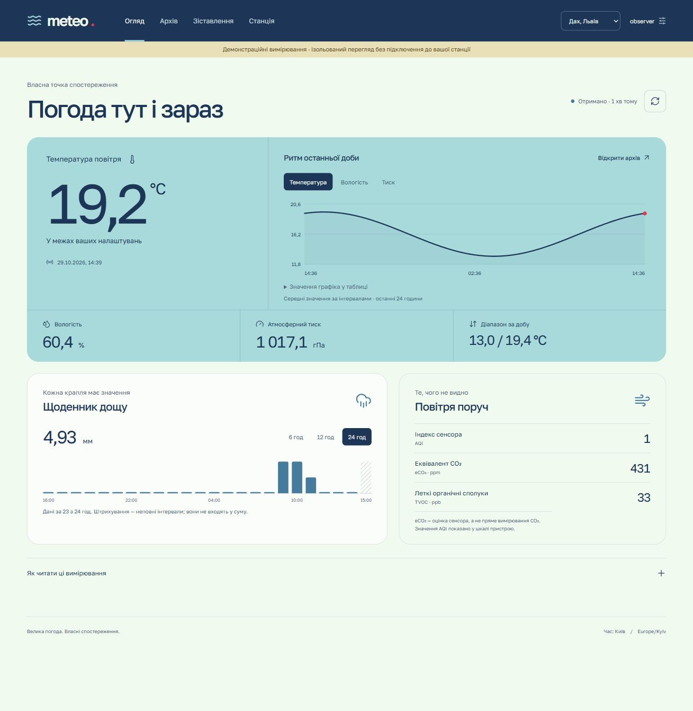

# Meteo · a personal weather station

A Flask/MongoDB application for an ESP32 weather station. The station collects
measurements and sends signed JSON. This application stores them and provides a
Ukrainian dashboard, history, rainfall analysis, and an OpenWeather comparison.



The Summer Ocean Breeze interface uses honeydew, frosted blue, cerulean, oxford
navy, and punch red. Fonts and icons are served locally. There is no frontend
framework, build step, CDN dependency, or charting dependency.

## Accounts and station connection

Create a username/password account at `/register`. Each account sees only its
connected stations. Every readings and settings route enforces the selected
station's ownership on the server; changing a URL or form value cannot grant
access to another account's station.

A server operator approves connection with a one-time pairing code:

```powershell
python -m tools.pair_station --device-id YOUR_DEVICE_ID
```

The device ID must exist in `AUTHORIZED_TOKENS`. Give the printed code privately
to its owner, who enters it on **My stations** (`/web/stations`). Codes expire
within 15 minutes, are stored as hashes, and can be redeemed once. Issuing a new
code invalidates the previous one for that device. A bound station must first be
disconnected by its owner before a new pairing code can be issued.

The switcher in the header changes the active station. Disconnecting retains its
measurements and configuration; reconnecting needs a fresh operator code. A new owner receives access to that station’s retained archive. The
browser never needs the ESP32's long-lived upload token.

Existing ESP32 upload signatures and token-bearing configuration requests remain
compatible. The inspected firmware already sends `Authorization` to `/api/config`.
Unpaired devices continue to receive the legacy configuration. After pairing,
configuration and alert thresholds are stored independently per station.

Old readings without a device ID are included only when the server has exactly
one configured device when it is first connected. With several configured
devices, unassigned legacy rows are not silently assigned to an arbitrary owner.
Plan an explicit migration if you need to attribute them.

### Sessions and deployment

Passwords use Werkzeug's scrypt hashing. Browser writes use session-bound CSRF
codes, including login, logout, settings, and station connection. Sessions last
12 hours, use HttpOnly/SameSite=Lax cookies, and rotate at login. Failed logins,
registration, and pairing attempts have per-process request limits.

HTTPS cookies are the default. For local HTTP development, set
`$env:METEO_COOKIE_SECURE = '0'` before starting the app. For production, keep
secure cookies enabled and provide a random `METEO_SESSION_SECRET` of at least
32 characters in the process environment. Without that variable, the app creates
an ignored `.session-secret` file; preserve it across restarts. Multiple instances
must share one session secret. Place a shared rate limit at the hosting edge if
running multiple processes or instances.

MongoDB needs read/write and index permissions for `meteo_users`,
`meteo_stations`, and `meteo_pairing_codes`, as well as the existing collections.
Unique indexes protect usernames and station ownership; pairing codes have a TTL
index in addition to explicit expiry checks. No old readings are rewritten.

Accounts currently use usernames and passwords; email verification and automated
password recovery are not implemented. Previously committed device secrets must
be rotated before relying on them again: removing Git paths does not revoke a
credential or erase copies elsewhere. Keep the pre-cleanup Git backup private.

## What the interface does

- **Overview:** latest local readings, explicit data age, a 24-hour temperature,
  humidity or pressure chart, hourly rainfall, and the device's air readings.
- **Archive:** 1-, 7-, and 30-day windows, chart metric selection, temperature
  statistics, and a journal of the latest 100 records in the selected window.
  CSV exports those journal records, with UTC timestamps and units in headings.
- **Comparison:** station readings beside OpenWeather **current conditions**,
  absolute differences, and the observation time of each source. It does not
  present the difference as a forecast-accuracy score.
- **Station:** reporting interval, coordinate search or manual coordinates,
  nullable temperature/humidity limits, validation, save, and discard changes.

Charts work with pointer, touch, and keyboard. Focus a chart and use Left/Right,
Home, or End to inspect points. A table alternative accompanies every line chart.
Reduced-motion preferences disable animated transitions.

## Run locally

Python 3.11 or newer is supported. Node 18+ is optional, for JavaScript tests only.

```powershell
python -m venv .venv
.\.venv\Scripts\Activate.ps1
python -m pip install -r requirements.txt
Copy-Item config/config_db.example.py config/config_db.py
Copy-Item .env.example secrets.env
```

Fill `secrets.env` with your MongoDB settings and device credentials, and add an
OpenWeather key if you want external comparison. Existing installations can keep
their current `config/config_db.py`; the redesign does not replace that file.
Keep the HMAC secret and authorization token identical to the ESP32's values.

```powershell
python app.py
```

The default address is `http://localhost:5000/web`. The `PORT` environment variable
can override the default. Other pages are `/web/history`, `/web/comparison`, and
`/web/settings`. Waitress serves the application; Flask's debugger is not enabled.

Browser data and configuration routes require an account with an owned station.
Device uploads still use the original authorization token and HMAC signature.

## Preview without a station or database

```powershell
python -m pip install -r requirements-dev.txt
python -m tools.preview
```

Visit `http://localhost:4302/web`. A visible banner identifies the sample data.
This tool replaces the database and external-weather boundary in memory before
loading the real routes. It never imports private configuration or connects to
MongoDB. Saving settings changes only the preview's memory. Sign in as `observer` with
password `ocean-breeze-demo` to inspect two sample stations. The station page
shows a sample pairing code for a third, unclaimed device so you can try account
registration and connection. Restart the preview to issue a fresh demo pairing code. These credentials and codes exist only in the
explicit preview tool, never in the production application.

## Tests

```powershell
python -m unittest discover -s tests -v
npm test
npm run check
```

Python tests cover timestamps, rainfall resets/gaps, configuration validation,
bounded query construction, rendering, and signed/unsigned device uploads.
JavaScript tests cover formatting, data freshness, zero values, form conversion,
and CSV output. They require no live services. Query-builder tests use a mock
collection; they do not replace testing aggregation support on your MongoDB.

## Read the code

Start with [the codebase guide](docs/CODEBASE.md). It explains how a reading moves
from the ESP32 to the screen, each module's responsibility, and where to make
common changes. [CONTRIBUTING.md](CONTRIBUTING.md) records the readability standard.

## API compatibility

The ESP32's `POST /api/data` body, `Authorization` header, and `X-Signature` HMAC
verification remain the same. Existing page URLs and data routes remain available.

The dashboard adds `GET /api/data/history?hours=24` (1–720 hours). It returns
time-bucket averages, temperature statistics, and at most 100 recent raw readings.
There are roughly 240 chart buckets per window, rather than every raw record.

Rainfall routes now return `rainfall_mm: null` and `complete: false` when an
interval lacks sufficient coverage or contains a counter reset. Consumers must
distinguish unknown from zero. Hourly queries are limited to 1–168 hours.
Configuration updates require ownership and a valid CSRF code; they validate known fields and preserve unedited nested fields.
`/api/data/stats` and `/api/data/all` remain legacy routes; the new UI uses the
bounded history route instead.

## Data and external sources

- Naive legacy timestamps are interpreted as UTC; explicit offsets are honored.
  The interface displays Europe/Kyiv time, including daylight-saving changes.
- Rainfall keeps the existing calibration: **0.987 mm per tip**. Adjacent counter
  differences are assigned to the later observation's hourly bucket. An interval
  needs a recent baseline and endpoint, no reset, and no gap longer than the
  larger of ten minutes or three configured reporting intervals. The open current
  hour is marked incomplete. Unknown hours are excluded from the displayed sum.
- eCO₂ is shown as a sensor estimate. The device's AQI is not relabelled as a
  standardized regional health index.
- [OpenWeather current conditions](https://openweathermap.org/current) supplies
  external comparison. Its sea-level pressure may differ from local pressure.
- Optional place search uses [Open-Meteo geocoding](https://open-meteo.com/en/docs/geocoding-api),
  with location data from GeoNames. Only an explicit search sends the entered
  place name; entering coordinates works without this service.
- Golos Text is from [Google Fonts](https://github.com/google/fonts/tree/main/ofl/golostext)
  (OFL). Icons are [Lucide](https://lucide.dev/) (ISC). Notices are in `static/licenses/`.

No migration rewrites existing sensor records. Account features create their own
unique and TTL indexes when first used. The compatibility queries normalize stored
strings inside MongoDB; the history range first narrows
the string dates. For a larger archive, a separately planned migration to an
indexed BSON date field will make chronological queries cheaper. Do not migrate
production timestamps without a backup and a compatibility plan for the device.

## Docker

The image excludes local keys, private configuration, Git metadata, and virtual
environments. It creates the configuration adapter from the tracked example;
provide real values at runtime rather than copying secrets into the image.

```powershell
docker build -t meteostation .
docker run --env-file secrets.env -e METEO_SESSION_SECRET -p 8080:8080 meteostation
```

Set `METEO_SESSION_SECRET` in your shell before this command. For an HTTP-only
local container, additionally pass `-e METEO_COOKIE_SECURE=0`; keep HTTPS-only
cookies in deployment. No hosting service is deployed by these source changes.
